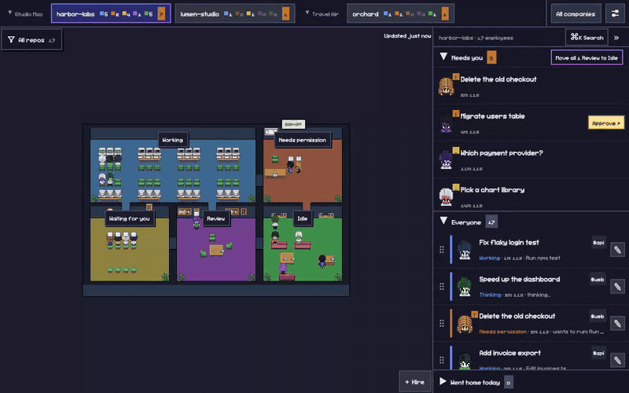
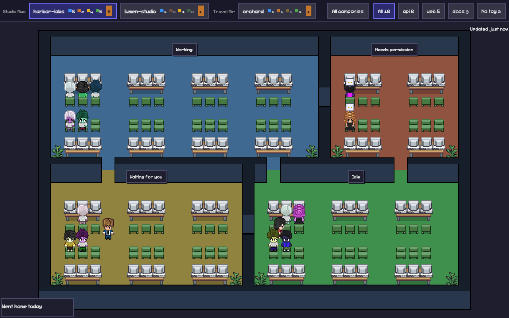
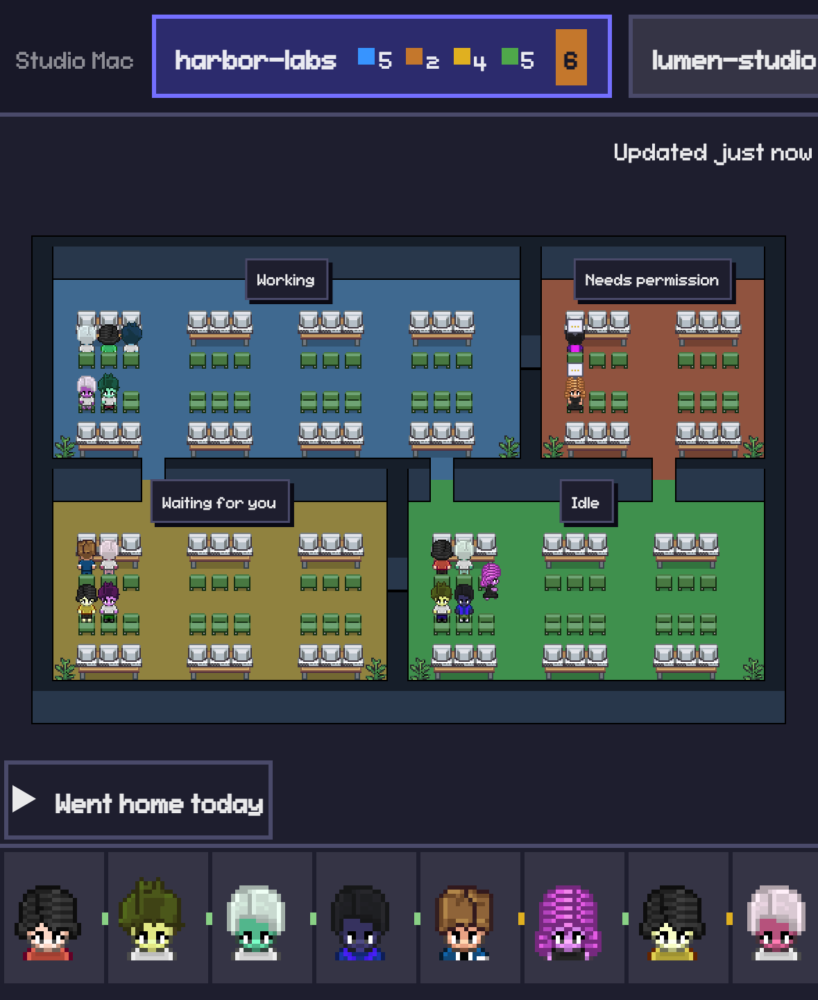
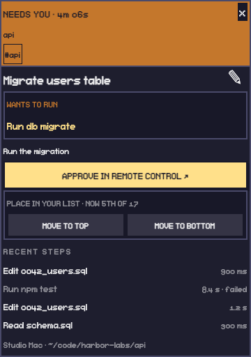

<h1 align="center">Claude Office</h1>

<p align="center">A pixel-art office that shows every Claude Code session on your Macs, live. Each session is an employee who walks between rooms as its state changes.</p>

<p align="center">
  <a href="https://github.com/votrungquan1999/claude-office/actions/workflows/ci.yml"></a>
  <a href="LICENSE"></a>
  
  
</p>

<p align="center">
  
</p>

## Features

- **Four rooms:** Working, Needs permission, Waiting for you and Idle. An employee walks to the room that matches its session, and the room signs count who is where.
- **Companies and projects:** the folders you start sessions in group into companies, one tab per company and Mac, each with four live counts and a badge when something needs you. A drawer lists every Mac and company and has a per-company on/off switch: switching a folder off makes its child folders companies, and sessions started in a switched-off folder go to one "Other" company per Mac.
- **Repo tags:** each employee shows the repos it worked in, and you can filter a company's office by tag.
- **Details panel:** click an employee for a pixel card with its state and how long it has been there, project and tags, the running step, the latest steps and a Remote Control button.
- **Phone layout:** pan and zoom the office, with a company drawer and bottom sheets.
- **Hire an employee:** the floating Hire button at the office's bottom-right opens a Terminal window on an online Mac, in one of its known folders, running Claude Code with Remote Control on your first message; its desk appears in that folder's company. **Wake** in the details card of an employee that went home today, or whose window closed, reopens that conversation in a Terminal window with the same Remote Control link, unless it is open somewhere else. **Dismiss** stops holding a hired or woken employee at its desk; it never closes the window or ends the conversation. It cannot message or stop a running session. Sign-in is Google only, for one allowed account.

<p align="center">
  
</p>

<p align="center">
  
  &nbsp;
  
</p>

## Quick start

1. **Deploy the web app.** Create a MongoDB database and a Google OAuth client, then set the environment variables on your host. See [Deploy the web app](#deploy-the-web-app).
2. **Connect each Mac.** Clone this repo on the Mac and run setup with your office URL. See [Connect each Mac](#connect-each-mac), or [let Claude Code do it](#set-it-up-with-claude-code).
3. **Open the office.** Sign in with the allowed Google account at your URL. Sessions appear as you start Claude Code.

## How it works

```
Claude Code hooks -> local agent (on each Mac) -> MongoDB <- web app <- your browser
```

- **Hooks:** a small script reduces each Claude Code event and hands it to the agent on the same Mac. It never blocks Claude and always exits quietly.
- **Agent:** a background job (launchd) on each Mac that tracks sessions and writes changes to MongoDB.
- **MongoDB:** the one shared database.
- **Web app:** a Next.js app that reads MongoDB and polls for changes while the tab is visible.

### What never leaves the Mac

- The text of shell commands.
- Tool output, error text and notification text.

The first message of a hire passes through the database so the Mac can pick it up. The Mac erases it from the order when it picks the order up, or the database deletes the order with the message after about 10 minutes if no Mac does. The Mac keeps it in a file only you can read, which the window's script deletes as soon as it has read it.

What is stored: the first message (cut to 60 characters) and the original request (the whole first message, pasted text included, up to 2,000 characters, gone when the session expires), Bash and Agent descriptions, search patterns, web queries and domains, file names, the session's name and folder paths, and the folder name of each repo a session worked in (shown as a tag), each with a short hashed key.

Two optional calls leave the Mac, both only if you set your own Anthropic API key (`anthropicApiKey` in `~/.claude-office/config.json`, see [SETUP.md](SETUP.md#optional-name-every-desk-with-an-anthropic-key)). The agent can ask Claude Haiku for a short task name of each session, sending only the first part of the first message, once per session. It can also ask Haiku, when a turn ends, whether the last answer asks you to reply, sending only the last part of that answer; without it a simple rule decides. At most 1,000 characters go out per call, straight to Anthropic. Without a key nothing is sent: the desk is named from the first message and the rule decides Waiting for you.

## FAQ

- **Does it work on Linux or Windows?** The web app runs anywhere Node runs, and you can open it from any browser. The agent that watches sessions uses launchd, so it needs macOS.
- **Can it control my sessions?** It can open a new one (hire) or reopen one that is not running (wake) but it cannot message or stop one that runs. The Remote Control button opens the session's own Remote Control page when Claude Code provides one.
- **Does it cost tokens?** No. It reads hook events and transcripts on your Mac and uses no model. The only exceptions are the optional Haiku calls above, which need your own key.
- **What leaves my Mac?** See [What never leaves the Mac](#what-never-leaves-the-mac).

## Requirements

- **Macs running Claude Code.** The agent uses launchd, so Windows and Linux are not supported for the agent.
- **Node 24 or newer** on each Mac (`.nvmrc` says 24).
- **A MongoDB database.** MongoDB Atlas free tier works. You need a connection string for a user with read and write access to one database.
- **A Google OAuth client** of type "Web application". Add these authorised redirect URIs:
  - `https://<your-domain>/api/auth/callback/google`
  - `http://localhost:3000/api/auth/callback/google` (only if you run it locally)
- **Somewhere to host a Next.js app.** Vercel or any Node host.

## Deploy the web app

Set these environment variables on your host. All are required except `MONGODB_DB`.

- `BETTER_AUTH_SECRET`: a long random string. Make one with `openssl rand -base64 32`.
- `BETTER_AUTH_URL`: the public URL of your deployment, for example `https://office.example.com`.
- `GOOGLE_CLIENT_ID`: from your Google OAuth client.
- `GOOGLE_CLIENT_SECRET`: from your Google OAuth client.
- `ALLOWED_EMAIL`: the only Google account allowed in. Any other account is refused.
- `MONGODB_URI`: your MongoDB connection string.
- `MONGODB_DB`: the database name. Defaults to `claude-office`.

Build and start:

```
npm install
npm run build
npm run start
```

On Vercel the build and start steps are the platform's usual Next.js ones; just set the variables.

Indexes are created for you. The web app builds them the first time it connects to the database, and the agent builds them each time it starts. You do not create them by hand.

Then open your URL and sign in with the allowed Google account.

## Connect each Mac

On every Mac you want in the office:

```
git clone https://github.com/votrungquan1999/claude-office.git
cd claude-office
```

Then follow [SETUP.md](SETUP.md). It is written for Claude Code to follow, but a person can read it too. It installs dependencies, connects the Mac, adds the hooks to `~/.claude/settings.json` and starts the agent at login.

**Run setup with your own address.** The default office URL in setup is the author's (`https://office.quanvo.dev`), not yours. Set `CLAUDE_OFFICE_URL` to your deployment or the Mac will try to connect to the wrong office:

```
CLAUDE_OFFICE_URL=https://<your-domain> npm run setup
```

Setup prints a link and an 8-character code, opens the link, and waits up to 10 minutes. Sign in, check that the page shows this Mac's name and the same code as the terminal, then click "Connect this Mac".

Running setup again is safe. It keeps a valid saved connection. To ask for a new approval and replace the saved connection, run:

```
CLAUDE_OFFICE_URL=https://<your-domain> npm run setup -- --reconnect
```

## Set it up with Claude Code

From the cloned repo, start Claude Code and paste this:

```
Set up Claude Office on this Mac. Read README.md and SETUP.md first.

1. Ask me for my deployed office URL. If I have not deployed the web app yet, help me deploy it first. List the environment variables it needs (see "Deploy the web app" in README.md) and pause while I create the MongoDB database and the Google OAuth client myself. Never ask me to paste a secret, connection string or client secret into this chat. I will set those in my host's dashboard (or in .env.local for local runs) myself.
2. Once I give you the URL, run the setup from SETUP.md on this Mac with CLAUDE_OFFICE_URL set to that URL, for example: CLAUDE_OFFICE_URL=https://<my-domain> npm run setup
3. When it prints the link and code, walk me through the one approval click: sign in with Google, check the page shows this Mac's name and the same code as the terminal, then click "Connect this Mac".
4. Verify the agent is running using the checks at the end of SETUP.md (step 5) and tell me the result.
```

## Uninstall

There is no uninstall command. [SETUP.md](SETUP.md) lists what to remove by hand: the hook entries in `~/.claude/settings.json`, the `~/.claude/claude-office` link, the launchd job and `~/.claude-office/`.

## Contributing

See [CONTRIBUTING.md](CONTRIBUTING.md) for running the app locally, the checks and how the tests work.

## Credits and licences

The renderer and art come from [Pixel Agents](https://github.com/pixel-agents-hq/pixel-agents) (MIT), and the character sprites are based on JIK-A-4's Metro City pack (CC0). See [THIRD_PARTY_NOTICES.md](THIRD_PARTY_NOTICES.md) for details.

This repository's own code is under the [MIT licence](LICENSE). Third-party parts keep their own licences.
